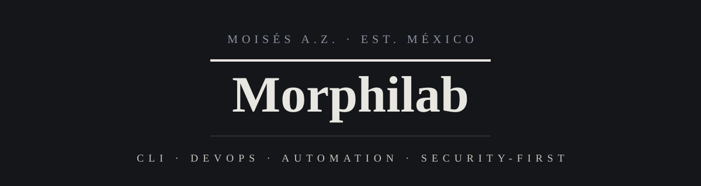

  

**English** · [Español](README.es.md)

 

**Hi, I'm Moisés.** I build open-source tools for software engineering, automation, and AI-assisted development.

---

### About me

I'm a software developer based in Mexico and the founder of **Morphilab**, a small open-source lab. My work spans command-line utilities, services, and desktop applications, from systems administration to AI-assisted software engineering.

I care about clear code, reversible operations, and keeping things simple enough to understand. The safe choice should be the default, and the final call should always be the user's.

---

### Stack

**Languages**

**Tools**

**Systems**

---

### Featured

<!-- BEGIN:destacado -->
**[morphix](https://github.com/Morphilab/morphix)** — Desktop multi-agent platform for AI-assisted software engineering: deterministic workflow engine, 5 agents, 24 tools, bot teams with rooms and routines, human-in-the-loop pauses and approvals, sandboxed execution, and offline via Ollama.

`Python` · `PostgreSQL` · `PySide6` · `MCP` · `LLMs`
<!-- END:destacado -->

---

### Project index

<!-- BEGIN:proyectos -->
`01` · **[ravenhub](https://github.com/Morphilab/ravenhub)** · `Go`

> Centralized notification hub for agents and workflows: one HTTP call, multi-channel delivery (Telegram, email, webhook, Discord, Slack), PostgreSQL queue, retries, audit, and scoped tokens.

`02` · **[copycrow](https://github.com/Morphilab/copycrow)** · `Shell`

> Automated and manual backups with Borg: guided TUI, native systemd timers, client-side encryption, deduplication, configurable retention, atomic per-job locks, and optional Proton Drive offsite replication.

`03` · **[sendorbit](https://github.com/Morphilab/sendorbit)** · `Shell`

> Security-first SSH/SCP/Rsync orchestration with TUI + CLI, automatic backups, input sanitization, and security logging.

`04` · **[TG-Sentry](https://github.com/Morphilab/TG-Sentry)** · `Python`

> Monitor and clean your own Telegram account over MTProto (Telethon): dry-run by default, explicit confirmation, anti-ban limits, full audit, and TUI + CLI.

`05` · **[theduckpurge](https://github.com/Morphilab/theduckpurge)** · `Shell`

> Privacy-first metadata sanitizer for PDFs, images, Office docs, audio, and video: 4 cleaning levels, CLI-only, 100% offline.

`06` · **[thefoxup](https://github.com/Morphilab/thefoxup)** · `Shell`

> Security-first Debian/Ubuntu updater — local and remote via SSH, with YAML config, parallel execution, lock protection, and ShellCheck-validated Bash.

`07` · **[iterecho](https://github.com/Morphilab/iterecho)** · `Python`

> Secure file processor: copy, concatenate, or chunk file trees with security-first validation.

`08` · **[nebulaforge](https://github.com/Morphilab/nebulaforge)** · `Python`

> Forge secure, auditable Conda environments.
<!-- END:proyectos -->

---

### Contact

---

**Open Source · Security · Automation**

© 2026 Moisés A.Z. / Morphilab · Made in Mexico 🇲🇽

⭐️ If any project is useful to you, a star is welcome.

